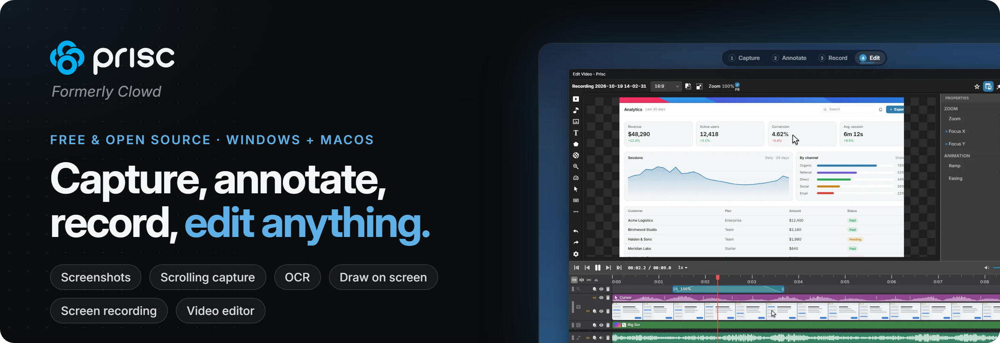

  

## Clowd is now Prisc

Clowd has been renamed to **Prisc**. It's the same free and open source app for capturing, annotating, recording and editing your screen, with a new name and a new home.

- **Website:** [prisc.app](https://prisc.app)
- **Source code and releases:** [github.com/priscapp/Prisc](https://github.com/priscapp/Prisc)
- **Download:** [prisc.app/download](https://prisc.app/download)

Existing Clowd installs keep updating automatically, and your settings and captures stay where they are. Links to the old `clowd/Clowd` repository redirect to the new one.

New development happens in the [priscapp](https://github.com/priscapp) organization.
